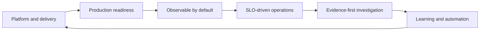

# Marco Cristofolini

**Principal / Staff Site Reliability Engineer · Platform Engineer**  
*Reliability engineering, cloud-native platforms and developer experience at scale.*

[Website](https://marcocristofolini.dev) · [LinkedIn](https://www.linkedin.com/in/marcocristofolini/) · [Versão em português](README_PT-BR.md)

I design, scale and operate **reliable distributed systems and internal developer platforms**. Across **13+ years** in SRE, DevOps and infrastructure engineering, I've worked with mission-critical 24×7 services, multi-cloud Kubernetes, infrastructure automation, observability and secure software delivery.

My approach: **make reliability measurable, platforms self-service, and incident investigations evidence-driven.**

## Selected experience & impact

- **Ambev / AB InBev — Principal SRE / Platform Engineer (2020–2023):** Led work on a **Backstage-based Internal Developer Platform** with a catalog of **800+ services**, supporting **hundreds of engineering squads** across Latin America and Europe. Built reusable Golden Paths, templates and self-service workflows.
- **Caju Benefícios — SRE Tech Lead / DevOps & Platform Engineer (2023–2026):** Advanced SLO-oriented operations, production readiness, multi-region AWS/EKS architectures, GitOps, observability, identity and security guardrails in a regulated fintech environment.
- **Endurance International Group / HostGator — Senior DevOps & Infrastructure Engineer (2013–2020):** Helped modernize high-volume hosting infrastructure, including on-premises-to-AWS migration. Automated environment provisioning **from hours to minutes** and strengthened 24×7 operations.

These are professional experience highlights, not claims that the personal repositories below run in those employers' production environments.

## Selected engineering projects

The projects below are **public reference implementations, labs or prototypes**. Each repository documents its own scope and validation status.

| Project | Focus and evidence |
| --- | --- |
| [Kubernetes Incident Evidence Collector](https://github.com/marcocristofolini/kubernetes-incident-evidence-collector) | Read-only **Python** CLI for Kubernetes incident evidence; reviewed prototype with mock-based tests. **Live-cluster validation is pending.** |
| [Kubernetes RCA Engine](https://github.com/marcocristofolini/kubernetes-rca-engine) | **Go**-based, evidence-first deterministic incident analysis for OOMKilled, evictions and CrashLoopBackOff; early **v0.1** implementation. |
| [Production Readiness Framework](https://github.com/marcocristofolini/production-readiness-framework) | Practical service reviews covering **SLOs, failure modes, overload protection, recovery and incident readiness**. |
| [Platform Engineering Reference](https://github.com/marcocristofolini/platform-engineering-reference) | **Backstage, Kubernetes and Argo CD** architecture examples for GitOps and developer self-service. |
| [Observability Stack](https://github.com/marcocristofolini/observability-stack) | Local **OpenTelemetry, Prometheus, Loki, Tempo and Grafana** reference stack. |
| [Terraform Cloud Platform](https://github.com/marcocristofolini/terraform-cloud-platform) | Modular **Terraform / OpenTofu** infrastructure patterns, with a deliberately small AWS networking example. |
| [Kubernetes SRE Playbook](https://github.com/marcocristofolini/kubernetes-sre-playbook) | Reproducible Kubernetes failure scenarios, investigation signals and troubleshooting runbooks. |

## Areas of expertise

| Discipline | Technologies and practices |
| --- | --- |
| **SRE & resilience** | SLIs / SLOs, error budgets, incident response, postmortems, production readiness, load shedding, graceful degradation, disaster recovery, capacity planning |
| **Platform & cloud-native** | Kubernetes, EKS / AKS / GKE, Backstage, Helm, Karpenter, KEDA, internal developer platforms, Golden Paths |
| **Cloud & infrastructure** | AWS, Google Cloud, Azure, Terraform, OpenTofu, Terragrunt, Pulumi (Go), Crossplane |
| **Delivery & GitOps** | Argo CD, Flux, Argo Rollouts, GitHub Actions, CI/CD, canary and blue-green deployments |
| **Observability** | OpenTelemetry, Prometheus, Grafana, Loki, Tempo, Datadog, New Relic, tracing, actionable alerting |
| **Security & identity** | Keycloak, Vault, IAM, RBAC, OPA / Rego, Gatekeeper, Kyverno, DevSecOps guardrails |
| **Engineering & operations** | Go, Python, Bash, TypeScript, Linux, Kafka, Redis, PostgreSQL, cost and capacity optimization |

## Certifications

- **Certified Kubernetes Administrator (CKA)** — CNCF, 2023
- **AWS Certified Solutions Architect – Associate** — AWS, 2023
- **Istio Certified Associate (ICA)** — CNCF, 2022
- **HashiCorp Certified: Terraform Associate** — HashiCorp, 2022
- **Site Reliability Engineering Nanodegree** — Udacity, 2017

*Credentials are listed as earned in my résumé; current expiration or renewal status is not asserted here.*

## Engineering principles

I favor **inspectable evidence over opaque conclusions**, safe operational defaults, incremental delivery and systems that engineers can confidently own.

**Languages:** Portuguese (native) · English (advanced professional) · Spanish (limited working proficiency)

**Connect:** [LinkedIn](https://www.linkedin.com/in/marcocristofolini/) · [marcocristofolini.dev](https://marcocristofolini.dev)
