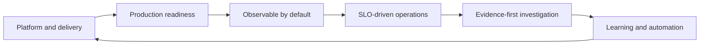

# Marco Cristofolini

**Principal Site Reliability Engineer · Cloud & Platform Engineering**

*Production reliability · multi-cloud architecture · platform engineering · evidence-driven incident response*

[Website](https://marcocristofolini.dev) · [LinkedIn](https://www.linkedin.com/in/marcocristofolini/) · [Versão em português](README_PT-BR.md)

I'm a **Principal Site Reliability Engineer** with **13+ years** designing, scaling and operating distributed systems and cloud platforms. My work spans hands-on production engineering, technical leadership and architecture across AWS, Azure and Google Cloud—from high-traffic infrastructure to regulated fintech and internal developer platforms.

I focus on **measurable reliability, safe delivery, developer self-service and evidence-based incident response**. I still enjoy troubleshooting the systems behind the architecture decisions.

## Selected experience & impact

- **Ambev / AB InBev — Principal SRE / Platform Engineer (2020–2023):** Led a **Backstage-based Internal Developer Platform** adopted by **250+ squads** across Latin America and Europe, with **800+ services** cataloged. Worked on multi-cloud Kubernetes (**AKS / EKS / GKE**), Azure DevOps, infrastructure standards, Golden Paths and self-service workflows.
- **Caju Benefícios — SRE Tech Lead / DevOps & Platform Engineer (2023–2026):** Led SRE and platform improvements across **12 squads, ~60 microservices and 5 EKS clusters**. Reduced MTTR from **120 to 40 minutes (~67%)**, increased critical-service availability from **99.5% to 99.9%**, and reduced AWS costs by **~28%**. Worked with **PCI-DSS requirements**, observability, GitOps and security controls in a regulated fintech environment.
- **Endurance International Group / HostGator — Senior DevOps & Infrastructure Engineer (2013–2020):** Helped modernize high-volume hosting infrastructure, including on-premises-to-AWS migration. Automated environment provisioning **from hours to minutes** and strengthened 24×7 operations.

These are professional experience highlights, not claims that the personal repositories below run in those employers' production environments.

## Featured project: [AI SRE RCA](https://github.com/marcocristofolini/ai-sre-rca)

An **evidence-first incident investigation workspace** for Kubernetes and distributed systems, combining a Next.js UI, FastAPI orchestration, PostgreSQL and scoped telemetry from Kubernetes, Prometheus, Loki and Tempo.

- **Deterministic RCA:** identifies verified failure mechanisms with traceable evidence; unsupported or missing evidence remains inconclusive. The optional AI Copilot explains findings but **does not override root-cause verdicts**.
- **Safe investigation workflow:** read-only evidence collection, explicit workload/time scope, tenant isolation, persisted investigations and specialist progress over SSE with replay/polling fallback. Remediation has a separate approval boundary.
- **Documented validation:** synthetic benchmarks and controlled local Kind/telemetry scenarios, with [test reports](https://github.com/marcocristofolini/ai-sre-rca#local-validation-recorded-results), [application screenshots](https://github.com/marcocristofolini/ai-sre-rca#application-screenshots--running-local-demo) and [architecture](https://github.com/marcocristofolini/ai-sre-rca#architecture-and-safety). **Development release candidate, not a claimed production deployment.**

## Selected engineering projects

These are **public reference implementations, labs or prototypes**. Each repository documents its scope and validation status.

| Project | Focus and evidence |
| --- | --- |
| **[AI SRE RCA](https://github.com/marcocristofolini/ai-sre-rca)** | Featured: evidence-linked deterministic RCA, opt-in AI Copilot and read-only, scoped investigations; controlled local validation documented above. |
| [Kubernetes Incident Evidence Collector](https://github.com/marcocristofolini/kubernetes-incident-evidence-collector) | Read-only **Python** CLI for Kubernetes incident evidence; reviewed prototype with mock-based tests. **Live-cluster validation is pending.** |
| [Kubernetes RCA Engine](https://github.com/marcocristofolini/kubernetes-rca-engine) | **Go**-based, evidence-first deterministic incident analysis for OOMKilled, evictions and CrashLoopBackOff; early **v0.1** implementation. |
| [Production Readiness Framework](https://github.com/marcocristofolini/production-readiness-framework) | Practical service reviews covering **SLOs, failure modes, overload protection, recovery and incident readiness**. |
| [Platform Engineering Reference](https://github.com/marcocristofolini/platform-engineering-reference) | **Backstage, Kubernetes and Argo CD** architecture examples for GitOps and developer self-service. |
| [Observability Stack](https://github.com/marcocristofolini/observability-stack) | Local **OpenTelemetry, Prometheus, Loki, Tempo and Grafana** reference stack. |
| [Terraform Cloud Platform](https://github.com/marcocristofolini/terraform-cloud-platform) | Modular **Terraform / OpenTofu** infrastructure patterns, with a deliberately small AWS networking example. |
| [Kubernetes SRE Playbook](https://github.com/marcocristofolini/kubernetes-sre-playbook) | Reproducible Kubernetes failure scenarios, investigation signals and troubleshooting runbooks. |

## Areas of expertise

| Discipline | Technologies and practices |
| --- | --- |
| **SRE & resilience** | SLIs / SLOs, error budgets, incident response, postmortems, production readiness, load shedding, graceful degradation, disaster recovery, capacity planning |
| **Platform & cloud-native** | Kubernetes, EKS / AKS / GKE, Backstage, Helm, Karpenter, KEDA, internal developer platforms, Golden Paths |
| **Cloud & infrastructure** | AWS, Azure / AKS, Google Cloud, Terraform, Bicep, OpenTofu, Terragrunt, Pulumi (Go), Crossplane |
| **Delivery & GitOps** | Argo CD, Flux, Argo Rollouts, GitHub Actions, CI/CD, canary and blue-green deployments |
| **Observability** | OpenTelemetry, Prometheus, Grafana, Loki, Tempo, Datadog, New Relic, tracing, actionable alerting |
| **Security & identity** | PCI-DSS-aware operations, IAM, RBAC, Keycloak, Vault, OPA / Rego, Gatekeeper, Kyverno, DevSecOps guardrails |
| **Engineering & operations** | Go, Python, Bash, TypeScript, Linux, Kafka, Redis, PostgreSQL, cost and capacity optimization |

## Certifications

- **Certified Kubernetes Administrator (CKA)** — CNCF, 2023
- **AWS Certified Solutions Architect – Associate** — AWS, 2023
- **Istio Certified Associate (ICA)** — CNCF, 2022
- **HashiCorp Certified: Terraform Associate** — HashiCorp, 2022
- **Site Reliability Engineering Nanodegree** — Udacity, 2017

*Credentials are listed as earned in my résumé; current expiration or renewal status is not asserted here.*

## Engineering principles

I favor **inspectable evidence over opaque conclusions**, safe operational defaults, incremental delivery and systems that engineers can confidently own.

**Languages:** Portuguese (native) · English (advanced professional) · Spanish (limited working proficiency)

**Connect:** [LinkedIn](https://www.linkedin.com/in/marcocristofolini/) · [marcocristofolini.dev](https://marcocristofolini.dev)
