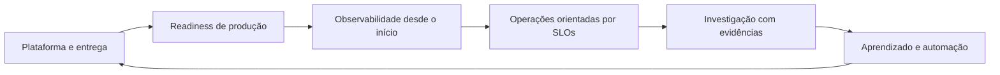

# Marco Cristofolini

**Principal Site Reliability Engineer · Engenharia de Cloud e Plataformas**

*Confiabilidade em produção · arquitetura multicloud · engenharia de plataformas · investigação de incidentes com evidências*

[Site](https://marcocristofolini.dev) · [LinkedIn](https://www.linkedin.com/in/marcocristofolini/) · [English version](README.md)

Sou **Principal Site Reliability Engineer**, com **mais de 13 anos** projetando, escalando e operando sistemas distribuídos e plataformas em nuvem. Minha trajetória combina engenharia prática de produção, liderança técnica e arquitetura em AWS, Azure e Google Cloud — de infraestrutura de alto tráfego a fintech regulada e plataformas internas para desenvolvedores.

Meu foco é **confiabilidade mensurável, entregas seguras, autosserviço para desenvolvedores e resposta a incidentes baseada em evidências**. Continuo gostando de investigar os sistemas por trás das decisões de arquitetura.

## Experiência e resultados em destaque

- **Ambev / AB InBev — Principal SRE / Platform Engineer (2020–2023):** Liderança de uma **plataforma interna baseada em Backstage** adotada por **mais de 250 squads** na América Latina e Europa, com **mais de 800 serviços** catalogados. Atuação em Kubernetes multicloud (**AKS / EKS / GKE**), Azure DevOps, padrões de infraestrutura, Golden Paths e autosserviço.
- **Caju Benefícios — SRE Tech Lead / DevOps & Platform Engineer (2023–2026):** Liderança de melhorias de SRE e plataforma para **12 squads, cerca de 60 microsserviços e 5 clusters EKS**. Redução do MTTR de **120 para 40 minutos (~67%)**, aumento de disponibilidade de serviços críticos de **99,5% para 99,9%** e redução de custos AWS em **~28%**. Experiência com **requisitos PCI-DSS**, observabilidade, GitOps e controles de segurança em fintech regulada.
- **Endurance International Group / HostGator — Senior DevOps & Infrastructure Engineer (2013–2020):** Modernização de infraestrutura de hospedagem em alta escala, incluindo migração de on-premises para AWS. Automação que reduziu o provisionamento de ambientes **de horas para minutos** e fortalecimento de operações 24×7.

Esses resultados são da experiência profissional e **não** significam que os repositórios pessoais abaixo tenham sido implantados nos ambientes de produção dessas empresas.

## Projeto em destaque: [AI SRE RCA](https://github.com/marcocristofolini/ai-sre-rca)

Workspace de **investigação de incidentes baseado em evidências** para Kubernetes e sistemas distribuídos, com interface Next.js, orquestração FastAPI, PostgreSQL e coleta de telemetria com escopo controlado de Kubernetes, Prometheus, Loki e Tempo.

- **RCA determinística:** identifica mecanismos de falha verificados com evidências rastreáveis; dados ausentes ou insuficientes levam a resultado inconclusivo. O Copilot opcional explica os achados, mas **não altera os vereditos de causa raiz**.
- **Investigação segura:** coleta somente leitura, seleção explícita de workload e intervalo de tempo, isolamento entre tenants, histórico persistido e progresso via SSE com replay e fallback para polling. A remediação exige aprovação em fluxo separado.
- **Validação documentada:** benchmarks sintéticos e cenários locais controlados em Kind, com [relatórios de testes](https://github.com/marcocristofolini/ai-sre-rca#local-validation-recorded-results), [capturas da aplicação](https://github.com/marcocristofolini/ai-sre-rca#application-screenshots--running-local-demo) e [arquitetura](https://github.com/marcocristofolini/ai-sre-rca#architecture-and-safety). **Release candidate em desenvolvimento; não há alegação de implantação em produção.**

## Projetos de engenharia selecionados

Os repositórios abaixo são **implementações de referência, laboratórios ou protótipos públicos**. Cada projeto documenta seu escopo e estágio de validação.

| Projeto | Foco e evidências |
| --- | --- |
| **[AI SRE RCA](https://github.com/marcocristofolini/ai-sre-rca)** | Destaque: RCA determinística com evidências, Copilot opcional e investigações controladas somente leitura; validação local documentada acima. |
| [Kubernetes Incident Evidence Collector](https://github.com/marcocristofolini/kubernetes-incident-evidence-collector) | CLI **Python** somente leitura para coleta de evidências de incidentes; protótipo revisado com testes mockados. **Validação em cluster real pendente.** |
| [Kubernetes RCA Engine](https://github.com/marcocristofolini/kubernetes-rca-engine) | Análise determinística de incidentes em **Go**, orientada a evidências, para OOMKilled, evictions e CrashLoopBackOff; implementação inicial **v0.1**. |
| [Production Readiness Framework](https://github.com/marcocristofolini/production-readiness-framework) | Revisões operacionais com **SLOs, modos de falha, proteção contra sobrecarga, recuperação e resposta a incidentes**. |
| [Platform Engineering Reference](https://github.com/marcocristofolini/platform-engineering-reference) | Exemplos arquiteturais com **Backstage, Kubernetes e Argo CD** para GitOps e autosserviço. |
| [Observability Stack](https://github.com/marcocristofolini/observability-stack) | Stack de referência local com **OpenTelemetry, Prometheus, Loki, Tempo e Grafana**. |
| [Terraform Cloud Platform](https://github.com/marcocristofolini/terraform-cloud-platform) | Padrões modulares com **Terraform / OpenTofu** e exemplo intencionalmente enxuto de rede AWS. |
| [Kubernetes SRE Playbook](https://github.com/marcocristofolini/kubernetes-sre-playbook) | Cenários reproduzíveis de falha, sinais de investigação e runbooks Kubernetes. |

## Competências principais

| Área | Tecnologias e práticas |
| --- | --- |
| **SRE e resiliência** | SLIs / SLOs, error budgets, resposta a incidentes, postmortems, production readiness, load shedding, graceful degradation, disaster recovery, capacity planning |
| **Platform Engineering** | Kubernetes, EKS / AKS / GKE, Backstage, Helm, Karpenter, KEDA, plataformas internas e Golden Paths |
| **Cloud e infraestrutura** | AWS, Azure / AKS, Google Cloud, Terraform, Bicep, OpenTofu, Terragrunt, Pulumi (Go), Crossplane |
| **Entrega e GitOps** | Argo CD, Flux, Argo Rollouts, GitHub Actions, CI/CD, canary e blue-green |
| **Observabilidade** | OpenTelemetry, Prometheus, Grafana, Loki, Tempo, Datadog, New Relic, tracing e alertas acionáveis |
| **Segurança e identidade** | Operação sob requisitos PCI-DSS, IAM, RBAC, Keycloak, Vault, OPA / Rego, Gatekeeper, Kyverno, controles DevSecOps |
| **Desenvolvimento e operações** | Go, Python, Bash, TypeScript, Linux, Kafka, Redis, PostgreSQL, otimização de custos e capacidade |

## Certificações

- **Certified Kubernetes Administrator (CKA)** — CNCF, 2023
- **AWS Certified Solutions Architect – Associate** — AWS, 2023
- **Istio Certified Associate (ICA)** — CNCF, 2022
- **HashiCorp Certified: Terraform Associate** — HashiCorp, 2022
- **Site Reliability Engineering Nanodegree** — Udacity, 2017

*As certificações estão listadas conforme o currículo; não estou afirmando o status atual de renovação ou validade.*

## Princípios de engenharia

Valorizo **evidências verificáveis em vez de conclusões opacas**, operações seguras por padrão, entregas incrementais e sistemas que os times consigam operar com autonomia.

**Idiomas:** Português (nativo) · Inglês (avançado profissional) · Espanhol (proficiência profissional limitada)

**Contato:** [LinkedIn](https://www.linkedin.com/in/marcocristofolini/) · [marcocristofolini.dev](https://marcocristofolini.dev)
